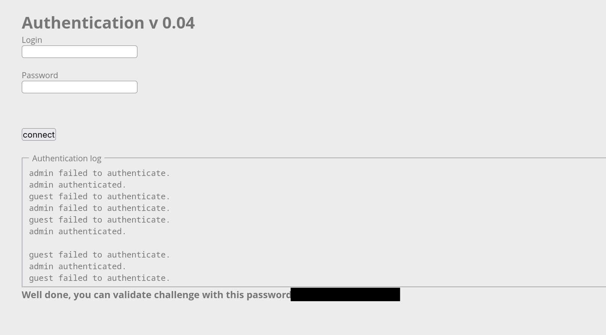

## CRLF Injection 

> Inject false data in the journalisation log.

**Challenge**: [link](https://www.root-me.org/en/Challenges/Web-Server/CRLF) 

---

> First, let's understand what exactly is CRLF Injection attack. CRLF stands for Carriage Return (\r) and Line Feed (\n), the two characters traditionally used to represent a line break. `\r` ending the line, `\n` starting a new line.

> Now assume you have a web page, and whatever you do is logged normally. For instance, if you send a POST login request, that includes your username/email, password, or any additional required data, they are stored inside the server's logs. Each log entry gets a new line, so they are not confused when analyzed. A basic sample would be from the challenge itself:

```
admin failed to authenticate.
admin authenticated.
guest failed to authenticate.
```

> A SOC Analyst would conclude that admin user failed authentication first time, and succeeded in the second attempt. But what if an attacker could inject a new line, making it seem like there has been a successful attack to a high-privileged user? This itself is not a high severity exposure, but confusing logs can halt SOC Analysts' jobs, or used as a distraction, drawing the attention to a decoy attack. 


--- 

## Challenge Solution

> Let's manipulate the logs to achieve the original log, to make it seem an admin authenticated, while appended `failed to authenticate` string is in a new line, and look as if a guest user failed to authenticate. We can solve this lab with Burp Suite, but I will proceed with manipulating the URL which goes like this:

```
/web-serveur/ch14/?username=admin&password=password
```

> Since the client-side restriction does not allow us to do `LSHIFT + ENTER`, we can use the URL-Encoded matching of `\r`. Which is: `%0A`.

> The URL becomes:

```
/web-serveur/ch14/?username=admin%20authenticated.%0Aguest&password=guest
```



> Flag is revealed, completing the challenge.
